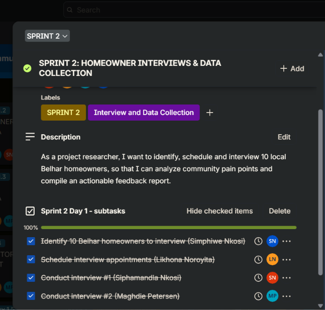
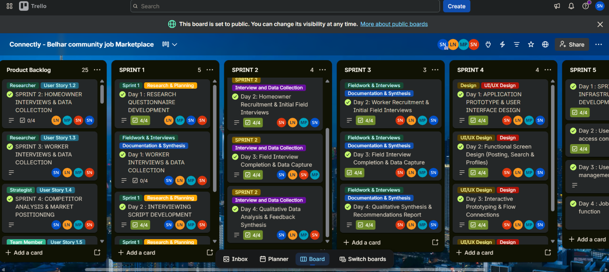
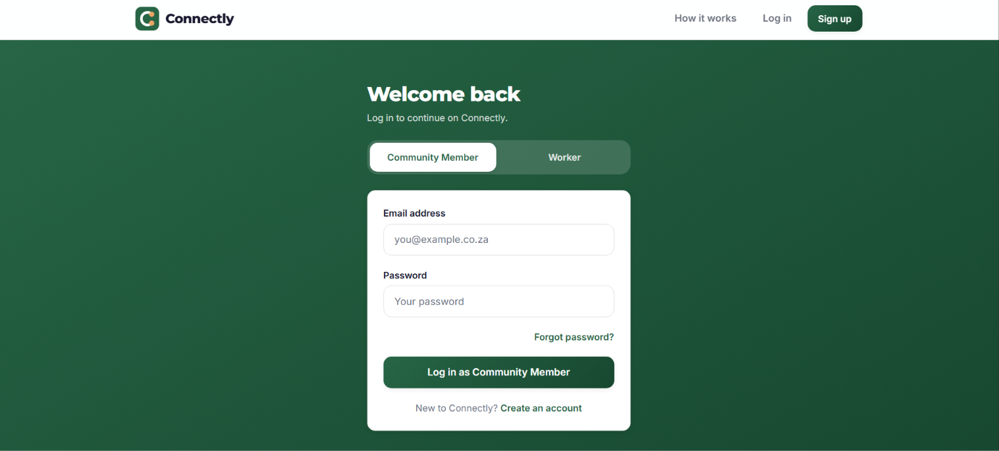
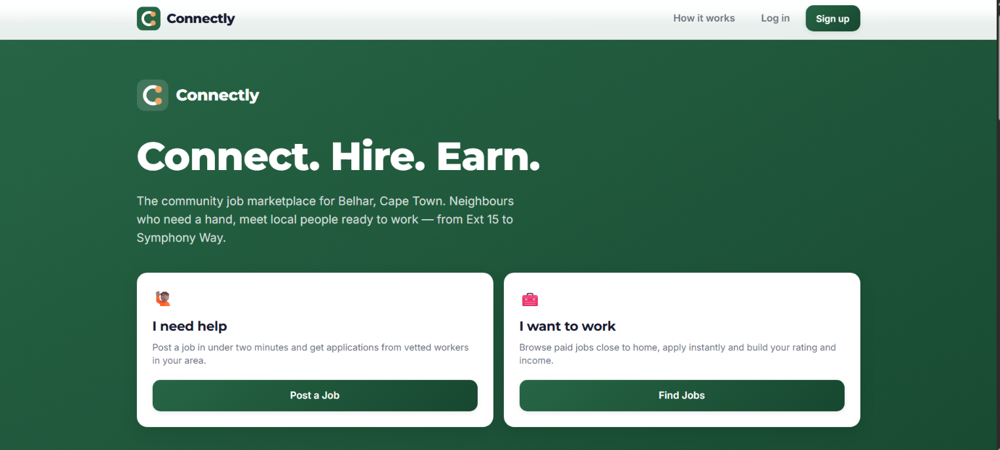

# Simphiwe Nkosi

> Software Engineering Student | ICT in Application Development

---

## 📞 Contact

📧 [221549323@mycput.ac.za](mailto:221549323@mycput.ac.za)  
📞 +27 66 381 5439  
📍 22 Barrack Street, Cape Town City Centre, 8000

---

## 🎯 Professional Summary

Software Engineer with hands-on experience in full stack web and mobile development, Machine Learning (AI), and cloud technologies (Azure). Strong foundation in Object-Oriented Programming, agile development, and UI/UX principles. Enthusiastic about applying technical skills to innovate projects while continuously learning and contributing to impactful digital solutions.

---

## 🎓 Education

### Diploma in ICT in Application Development *(In Progress)*
**Cape Peninsula University of Technology, Cape Town** | 2024-2026

### National Senior Certificate
**Thuto-Thebe-Sec-School, Mpumalanga, Standerton** | 2015-2020

---

## 🛠️ Technical Skills

| Category | Technologies |
|----------|--------------|
| **Frontend** | HTML, CSS, JavaScript |
| **Backend** | Java, Python |
| **Databases** | SQL, MySQL |
| **AI/ML** | Machine Learning |
| **Tools** | Git, GitHub, Figma, PyCharm, IntelliJ |
| **Soft Skills** | Excellent communication |

---

## 💼 Experience

### Data and AI Intern
**Netcampus Kagisang [KGS] Project** | March 2025 - February 2026
*1 Century Blvd, Century, Cape Town*

- Completed a 12-month program focused on Microsoft Azure, data fundamentals, and AI solutions
- Earned Microsoft certifications: DP-900 (Azure Data Fundamentals) and AI-900 (Azure AI Fundamentals)
- Gained practical experience with Microsoft Copilot
- Provided end-user support for cloud-based tools

---

## 📁 Projects

### Inventory Management System
*Java | JavaScript | HTML/CSS | MySQL*

- Built a complete web-based inventory system using Java for server-side logic
- Designed a clean, responsive interface with HTML and CSS for managing products and stock levels
- Created a MySQL database to track inventory items, quantities, and transactions
- Implemented search and filter features allowing users to quickly find products

---

## 🤝 Agile Project: Connectly

**Connectly** is a community job marketplace for Belhar, Cape Town. It connects neighbours who need help with local workers. I worked in a team of four and was the group leader for Sprints 1 to 3.

**Links to evidence**
- 🌐 Live web app: https://belhar-connect-hublatestt.vercel.app/
- 📋 Trello board: https://trello.com/b/zpUv80Sx/connectly-belhar-community-job-marketplace
- 💻 GitHub repository: https://github.com/sphaace8-cpu/belhar-connect-hub_latestt

### Agile Team Charter

**Evidence:** The team agreed on a shared purpose, core values (community first, trust and safety, transparency, quality and respect), and working agreements. These include a daily stand-up, a weekly review and a WhatsApp group call to discuss progress and plan the next tasks. We used Trello, Google Drive, GitHub and Figma.

**Reflection:** As group leader, I set up the meetings, tracked progress and assigned tasks. I learnt that some team members need clear instructions and regular reminders to submit their work. I also learnt that I need patience.

### User Stories and Tasks

**Evidence:** The team wrote 25 user stories in seven epics: research, project management, design and brand, platform features, marketing, administration and launch. Each story was broken into daily tasks on Trello.

**Reflection:** Writing user stories was hardest because we had to think like a homeowner and a worker at the same time. We had to understand what each needed from a service, make sure both would benefit, and keep homeowners' safety in mind, since they are letting a stranger into their home.

### Product Backlog

**Evidence:** The product backlog lists 26 sprints. The team agreed on their order: gather information from the community first, then design, build the features, and finally publish and deploy the web app.

**Reflection:** Putting the sprints in this order meant each stage was based on what we had learnt before it.

### Sprint Backlog

**Evidence:** I led Sprints 1 to 3. The daily tasks and their completion are recorded on Trello, and the full day-by-day breakdown is in the logbooks below.
- **Sprint 1, research questionnaire development:** drafted interview questions and scripts for homeowners and workers, tested them, prepared consent forms, and stored the materials in Google Drive.
- **Sprint 2, homeowner interviews:** recruited homeowners in Belhar, carried out interviews, captured the data, and presented the findings to the team.
- **Sprint 3, worker interviews:** interviewed local workers, analysed their feedback, and wrote a summary report.

**Reflection:** The research and documentation went as planned. Some community members did not want to take part, but we found several who agreed to be interviewed. Next time I would arrange interviews on a weekend, when more community members are at home.

### Sprints 4 to 15

**Evidence:** After the research sprints, the team designed the app's screens and interactive prototype in Figma (Sprint 4). We then set up the technical foundation and built the core features. The web application is now live at the link above. Users can create an account, verify their email, log in, post a job, search for jobs, apply for work and send messages.

**My contribution:** During the coding phase, I built and tested the payment method, which lets workers enter their banking details so they can be paid after completing a job. It works on the live app.

**Security:** Banking details entered by workers are encrypted, and Supabase access rules limit who can read them. Account verification and password reset were also added.

### Agile Logbook

**Evidence:** The team's daily stand-ups, sprint days and tasks were tracked over the project, from 14 July to 28 August 2026. The logbooks are in the `logbooks` folder:
- [Logbook 1: Sprint 1, 14 to 17 July 2026](logbooks/Connectly_Logbook_1_Sprint1_14-17_July.docx)
- [Logbook 2: Sprint 2, 21 to 24 July 2026](logbooks/Connectly_Logbook_2_Sprint2_21-24_July.docx)
- [Logbook 3: Sprint 3, 28 to 31 July 2026](logbooks/Connectly_Logbook_3_Sprint3_28-31_July.docx)
- [Logbook 4: Sprint 4, 4 to 7 August 2026](logbooks/Connectly_Logbook_4_Sprint4_4-7_August.docx)
- [Logbook 5: Sprint 12, 11 to 14 August 2026](logbooks/Connectly_Logbook_5_Sprint12_11-14_August.docx)
- [Logbook 6: Sprints 13 and 14, 18 to 21 August 2026](logbooks/Connectly_Logbook_6_Sprint13-14_18-21_August.docx)
- [Logbook 7: Sprint 15, 25 to 28 August 2026](logbooks/Connectly_Logbook_7_Sprint15_25-28_August.docx)

**Reflection:** Progress stayed steady across Sprints 1 to 3 because everyone contributed to their own tasks, and nothing slowed us down. Stand-ups were held daily, and the weekly review and WhatsApp call kept the team on track.

---

## 🏅 Certifications

- ✅ Microsoft DP-900: Azure Data Fundamentals
- ✅ Microsoft AI-900: Azure AI Fundamentals

---

## 📝 Reflections

### 1. Reflection on the use of .md (Markdown)

**One sentence summary:**  
Using Markdown helped me build a clean, professional portfolio quickly without needing to learn complex coding for a website.

**Situation**  
I had all my info ready — skills, projects, certifications — but putting it in a plain text file looked boring. I didn't want to spend time building a full website from scratch either.

**Task**  
I needed a simple way to format my README so it looked neat, was easy to read on any device, and could be updated fast whenever I finished something new.

**Action**  
I learned Markdown as I went. I used headings (`#`, `##`), tables for my skills and references, bold text for emphasis, and even snuck in a little HTML to embed my video. I also added lines (`---`) to separate sections clearly.

**Results**  
Now my portfolio looks clean and professional. I can update it in a few seconds from my phone or laptop, and anyone who visits my GitHub sees a proper, organized page — not a messy text file.

---

### 2. Reflection on my mock video

**One sentence summary:**  
Recording a mock interview video pushed me to practice talking about my work out loud, and showed me exactly what I need to improve.

**Situation**  
I wanted my portfolio to show more than just code — I wanted to prove I can actually talk about my projects. So I decided to record a mock interview video.

**Task**  
The hard part was speaking clearly about my Inventory Management System and AI internship without reading from notes, while keeping eye contact with the camera and staying under two minutes.

**Action**  
I used my phone, did a few takes, and picked the best one. Then I trimmed the silence using an online video cutter and embedded it into my README with a simple HTML video tag.

**Results**  
The video adds a real human touch to my portfolio. Watching myself back, I noticed I talk a little too fast — so now I practice slowing down. That alone was worth doing this.

---

### 3. Reflection on the deployment on GitHub

**One sentence summary:**  
Deploying with GitHub Pages turned my README into a live website in just a few clicks, with no hosting costs.

**Situation**  
After finishing my README, it was only visible as a raw file inside my repository. I wanted anyone with a link to see it as a real, styled webpage.

**Task**  
I needed to publish my portfolio online so employers could visit `simphiwe55.github.io` and see everything properly — video, tables, formatting — without downloading anything.

**Action**  
I went into my repository settings, turned on GitHub Pages, and set it to use my `main` branch. GitHub did the rest. I tested the link on my phone and laptop to make sure everything worked.

**Results**  
Now my portfolio is live for free. Every time I update my README, the website updates automatically within a minute or two. I also learned how static hosting works, which is useful for future projects.

---

## 🎥 Mock Interview Video

<video width="280" controls style="border-radius: 8px;"> <source src="./20260309_174814%20(online-video-cutter.com).mp4" type="video/mp4"> Your browser does not support the video tag. </video>

---

## 👥 References

| Name | Position | Contact |
|------|----------|---------|
| Mr. Cole Davis | Pillar 5 Group CEO | 064 538 6885 |
| Shamisio Sagomba | Pillar 5 Group Project Manager | 067 720 3214 |

---

*Last updated: November 2026*
